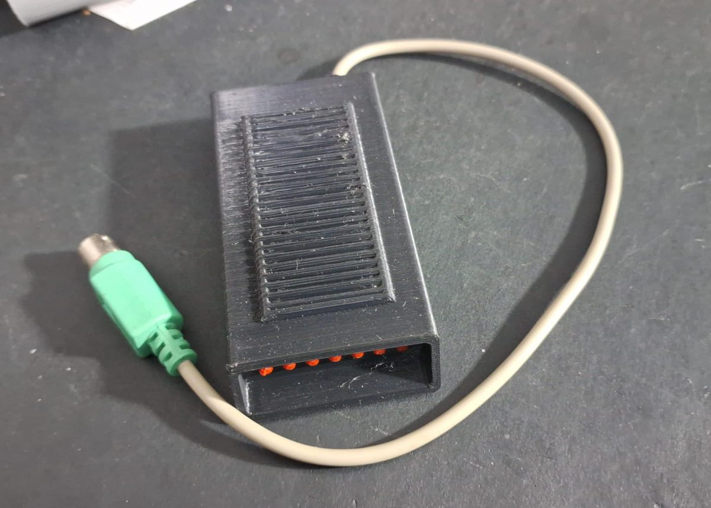
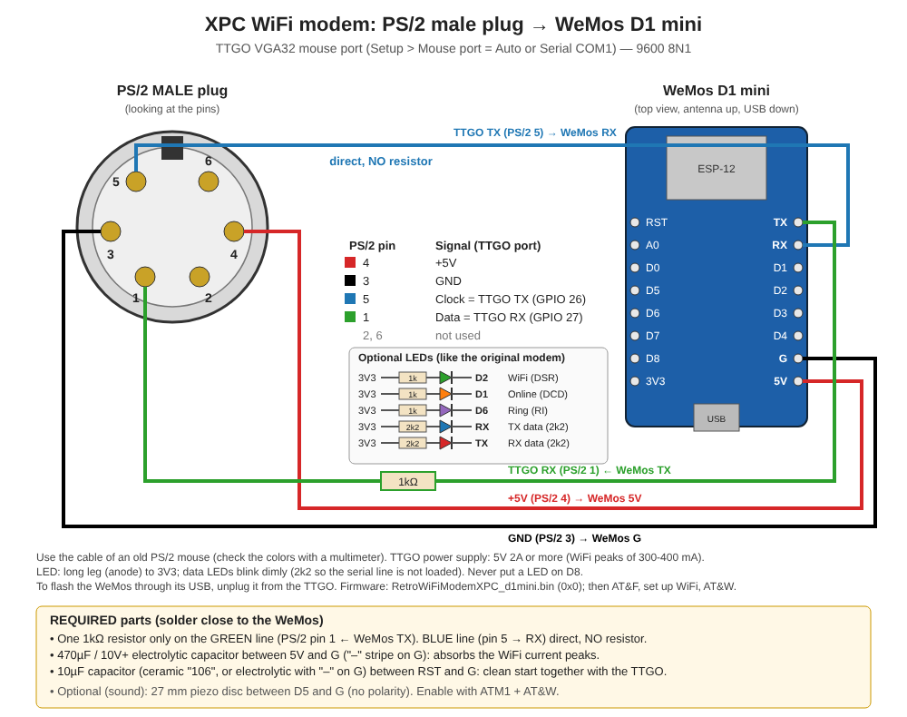

# XPC Mini Modem — a WiFi "Hayes" modem in the PS/2 mouse port

A **WeMos D1 mini** (ESP8266) wired to a PS/2 plug becomes a WiFi modem for the **[XPC ESP32](https://github.com/lgpf/xpc-esp32)** emulator. Plug it into the TTGO VGA32 **mouse port**, set *Mouse port* to `Serial COM1` (or `Auto`), and any DOS terminal — Telix, Procomm, Qmodem — can dial telnet BBSes with `ATDT host:port`.



And it sounds right: before connecting, a small piezo plays the **Brazilian dial tone, the DTMF digits, the ring-back and a real modem handshake**. After `CONNECT`, silence.

The firmware is a variant of **RetroWiFiModem** (ESP8266 RS232↔WiFi modem with Hayes AT commands), adapted to run without the MAX3232, the DFPlayer and the RS232 control lines.

---

## Why

The XPC is a complete PC/XT on a single board, and a PC/XT of the BBS era deserves a modem. Running the modem inside the ESP32 was not possible (not enough internal RAM next to the emulator), so it went *outside*, into the one free connector: the PS/2 mouse port, which already carries **5 V, GND and two data lines**. No extra cables, no level shifter, no external supply.

## Hardware

| Part | Notes |
|---|---|
| WeMos D1 mini (ESP8266, CH340) | not the "D1 mini ESP32" |
| PS/2 male plug with cable | from an old mouse or keyboard extension |
| 1 resistor 1 kΩ | only on the modem TX line |
| 1 electrolytic capacitor 470 µF / 10 V+ | between 5V and G — absorbs WiFi current peaks |
| 1 capacitor 10 µF (ceramic "106" or electrolytic) | between RST and G — clean start together with the TTGO |
| 1 piezo disc 27 mm (passive), optional | between D5 and G — dial/handshake sounds |
| 3D-printed case | see the table below |

All parts are through-hole.

### 3D-printed case

| File | Material | Notes |
|---|---|---|
| [`stl/xpc-minimodem-top.stl`](stl/xpc-minimodem-top.stl) | PLA | top with the sound grille (piezo glued by its brass rim) |
| [`stl/xpc-minimodem-bottom.stl`](stl/xpc-minimodem-bottom.stl) | PLA | bottom |
| [`stl/xpc-minimodem-cable-tpu.stl`](stl/xpc-minimodem-cable-tpu.stl) | **TPU** (flexible) | cable strain relief — fits the case cutout, locks the cable inside and leaves 1 cm of flexible boot outside to keep the cable from bending sharply |

### Wiring



| PS/2 pin | Signal (TTGO side) | WeMos |
|---|---|---|
| 4 | +5 V | 5V |
| 3 | GND | G |
| 5 | Clock = TTGO **TX** (GPIO 26) | **RX** — direct, **no resistor** |
| 1 | Data = TTGO **RX** (GPIO 27) | **TX** — through **1 kΩ** |
| 2, 6 | not used | — |

**Do not put a resistor on the pin 5 → RX line.** The WeMos USB chip (CH340) holds RX high through 470 Ω; with a series resistor the ESP32 cannot pull the line low and the modem never receives commands (you see its boot garbage, but `AT` gets no answer).

Optional status LEDs (anode to 3V3): D2 = WiFi, D1 = online, D6 = ring (1 kΩ); RX/TX activity (2.2 kΩ). Never put a LED on D8.

## Firmware

Flash `bin/RetroWiFiModemXPC_d1mini.bin` at **0x0** through the WeMos USB port (disconnect it from the TTGO first):

```
esptool.py --chip esp8266 --port COM5 erase_flash
esptool.py --chip esp8266 --port COM5 --baud 460800 write_flash -fm dio -fs 4MB 0x0 bin/RetroWiFiModemXPC_d1mini.bin
```

**With Espressif's Flash Download Tool (Windows):**

1. Run `flash_download_tool_x.x.x.exe`, choose **ChipType: ESP8266**, **WorkMode: Develop**, **LoadMode: UART**.
2. In the first line, tick the box, pick `bin/RetroWiFiModemXPC_d1mini.bin` and type **0x0** in the address field (`@ 0x0`).
3. **SPI SPEED: 40MHz**, **SPI MODE: DIO**, **FLASH SIZE: 32Mbit** (4 MB), leave *DoNotChgBin* ticked.
4. Select the WeMos **COM** port (CH340) and **BAUD 460800**.
5. Click **ERASE** and wait for *FINISH* (clears old WiFi settings).
6. Click **START** and wait for *FINISH*. The WeMos D1 mini enters flash mode by itself; after *FINISH* press its RST button.

Then, still on USB, with any serial terminal at **9600 8N1**:

```
AT&F                     factory defaults (9600, no flow control, DTR ignored)
AT$SSID=YourNetwork
AT$PASS=YourPassword
ATC1                     connect to WiFi
ATM1                     sounds on (ATM0 = off)
ATL2                     volume (0-1 normal, 2 loud, 3 max)
AT&W                     save
```

## Using it with the XPC

1. With the TTGO off, plug the modem into the **mouse** port.
2. XPC Setup → *Mouse port* → `Serial COM1` (or `Auto`: with no mouse at boot the port becomes COM1).
3. In DOS, configure the terminal for **COM1 (3F8h, IRQ4), 9600 8N1**, **no XON/XOFF**, DTR/DSR off.
4. Dial: `ATDT bbs.example.com:23`. Hang up: wait 1 s, `+++`, wait 1 s, `ATH` (Telix: `Alt+H`).

Telix notes: init string `AT S7=45 S0=0 V1 X4^M` works (registers S3–S12 are accepted and ignored, X2–X4 are accepted); set *Drop DTR to hangup* = Off (there is no DTR wire). The terminal always shows "Online" because there is no carrier-detect wire either — harmless.

## Sounds

Played only before the connection, Brazilian telephone standard, through a timer interrupt so the ring-back keeps playing while the TCP connection is being made. Previews in [`sounds/`](sounds).

| Situation | Sound | Result |
|---|---|---|
| WiFi not connected | none | `NO CARRIER` immediately |
| Connected | 425 Hz dial tone → DTMF *3372234* → two rings → recorded handshake | `CONNECT 9600` |
| Server refused (port closed) | dial tone → DTMF → one ring → busy tone | `BUSY` |
| Host not found / no answer | dial tone → DTMF → ringing until timeout | `NO CARRIER` |

A key pressed during dialing cancels the call.

## Changes from RetroWiFiModem

All changes are behind `#define XPC_DIRECT 1` in `RetroWiFiModem.h`:

- no DFPlayer, no RTS/CTS, DTR ignored, 9600 bps default;
- new sound engine for a piezo on D5 (`xpcsound.h`, `handshake.h`), `ATM`/`ATL` control it;
- dial sequence: WiFi check first, hostname resolved before ringing, ring-back during the connection attempt, new `BUSY` result (code 7);
- AT parser: S3–S12 accepted, X2–X4 accepted, `AT?` always shows help, an invalid command answers `ERROR` once instead of looping.

Build: Arduino ESP8266 core **3.1.2**, board *LOLIN(WEMOS) D1 R2 & mini*, lwIP *v2 Higher Bandwidth*, library **ESP_EEPROM**.

## Credits

- RetroWiFiModem — original source © 2016 Jussi Salin; additions © 2018 Daniel Jameson, Stardot contributors, Paul Rickards; fork at [lgpf/RetroWiFiModem](https://github.com/lgpf/RetroWiFiModem).
- XPC variant, wiring and case — RetroLabs: JL Martins and Luiz Pacheco, 2026.

## License

GPL v3 (see [LICENSE](LICENSE)), same as RetroWiFiModem.
